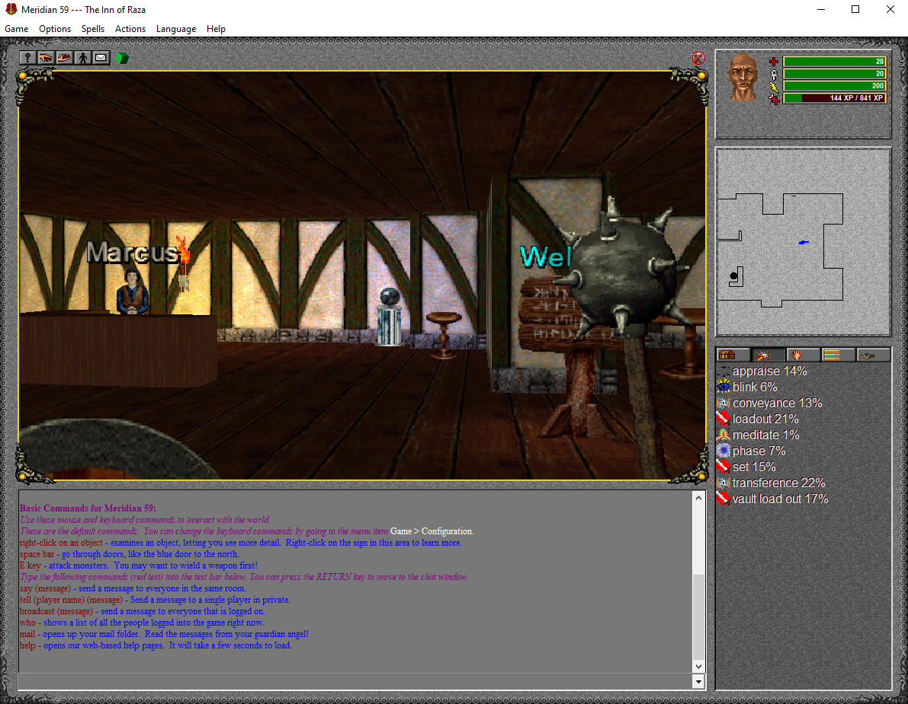
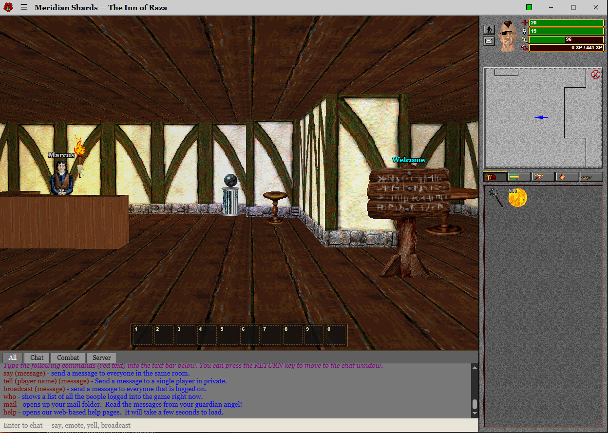
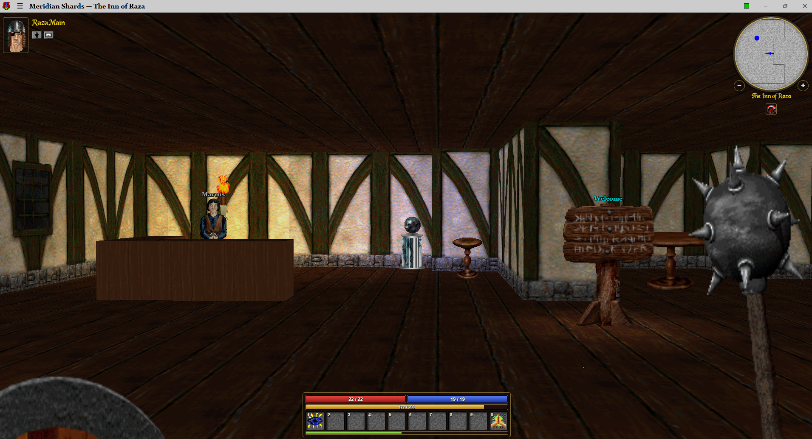
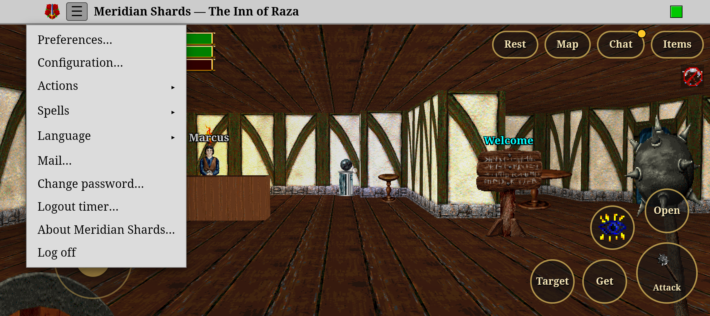
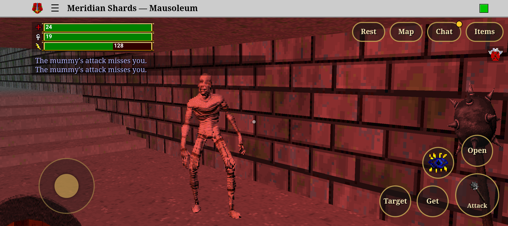
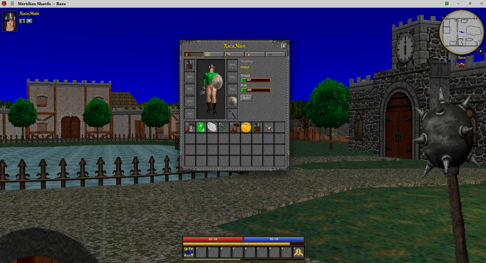
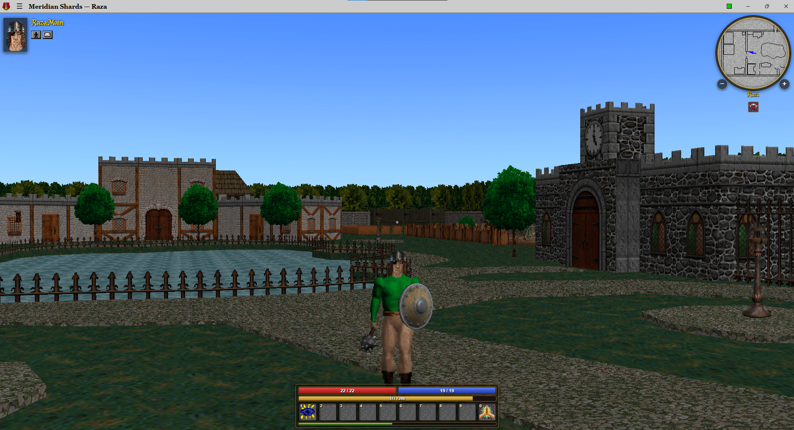

# Meridian Shards

A faithful port of the classic Meridian 59 client to the desktop (Windows, macOS and Linux) and Android: the original 2.5D look, sprites and textures, rendered with WebGL at modern resolutions, with modern controls beside the original ones. It connects to our own server, [shards-server](https://github.com/jboullion/shards-server), a fork of the Server 104 code that has been reworked a great deal (see [What is different](#what-is-different-from-the-original)). Every server is a "shard" of one original universe.

## Screenshots

The Inn of Raza in the original Windows client (left), and in Meridian Shards on the desktop with the original's interface (middle) and our Modern interface (right):

<table>
  <tr>
    <td width="33%"></td>
    <td width="33%"></td>
    <td width="33%"></td>
  </tr>
  <tr>
    <td align="center">The original client</td>
    <td align="center">Meridian Shards, Classic interface</td>
    <td align="center">Meridian Shards, Modern interface</td>
  </tr>
</table>

On an Android phone, with the touch controls, the ☰ menu open, and a fight in the Mausoleum:





## The Modern interface

The desktop app starts in the Modern interface. The original's layout, with the interface column beside the view, is a checkbox away in Configuration.

- **The view fills the window**, with the interface over it: your face top left, the round minimap top right, and along the bottom your health, mana, vigor and experience bars and ten quick slots (1 to 0) for spells and items. The chat runs down the left and fades when it's quiet.
- **The character window** (I) shows what you wear and wield on a figure of your character, next to your weight, bulk and inventory, with a Sort button. Its tabs hold your stats, spells, skills and quests. Drag it anywhere on the screen.
- **Camera views** (V or the mouse wheel): first person, a chase camera, over the shoulder, and from the front. H hides the interface for a clear view, and HUD Size in Configuration scales it.
- **Enhanced Lighting**, on by default: soft highlights, flickering and glowing flames, light that stops at walls, shaded corners, shadows under figures and a vignette. Turn it off in Configuration for the original's look.

<table>
  <tr>
    <td width="50%"></td>
    <td width="50%"></td>
  </tr>
  <tr>
    <td align="center">The character window</td>
    <td align="center">A third-person view</td>
  </tr>
</table>

## Status

The client does what the original client and its modules do, plus the windows for the systems our server adds (below). What's still missing from the original is listed, with the original's source for each, in [docs/missing-features.md](docs/missing-features.md).

- **The world:** every room drawn as the original D3D client draws it, with its lighting, sky, sun and moon, weather, and rooms that change (lifts, doors, the Raza clock). Objects, players and monsters are drawn, lit and animated, with blur, waver and flashing effects. Walking uses the original's movement code.
- **Playing:**
  - fighting with a weapon in hand, casting spells (with a Spells menu by school), dying and leaving the Underworld;
  - looking at things, picking up and dropping, containers, trading with players, shops, the bank and the vault;
  - chat with tabs (All, Chat, Combat, Server), tells, groups, emotes and moods, and the original's typed commands and aliases;
  - mail, the news globes, guilds, stat reallocation, chess, and the original's full character creator.
- **The interface:** the original's column (bars, face, enchantments, minimap with notes, the inventory, stats, spells, skills and quests tabs), toolbar, cursors, stone borders, and its Preferences, Configuration (key bindings) and Actions windows. The controls come in a modern (WASD, mouselook) preset and the original's keys. There's also a profanity filter, a logout timer, a language choice (English, German, Portuguese) and the splash screen.
- **Ours on top:** the Modern interface (above), Enhanced Lighting with moods, a moving sun and shadows ([ADR 0017](docs/adr/0017-lighting-moods.md)), seasons, enhanced water and glowing windows ([ADR 0018](docs/adr/0018-seasons-water-windows.md)), spell effects, damage numbers, chat tabs, emoji and item links in chat ([ADR 0024](docs/adr/0024-chat-emoji-and-item-links.md)), a latency meter, and pixel-accurate clicking.
- **Game systems our server adds** (each with its window in the client):
  - **Quests** you can find, with a quest log and giver dialogs ([ADR 0009](docs/adr/0009-quests.md)); **companions** and **pets** ([ADR 0010](docs/adr/0010-followers.md), [0006](docs/adr/0006-pets.md)); **friends** ([0005](docs/adr/0005-friends.md), [0015](docs/adr/0015-social-on-our-server.md)).
  - **Factions and the Faction War**, the only open-world PvP: renown, battles over the flagpoles, campaigns, the War window and the battle banner ([ADR 0021](docs/adr/0021-factions-and-the-faction-war.md)).
  - **Guilds**: halls, ranked chests, a recruitment board, the Fallen Halls, guild quests, trophies and cloaks, in the guild window's Hall, Trophies and Recruitment tabs ([ADR 0022](docs/adr/0022-guilds.md)).
  - **Spells** reworked by school, with the Jala songs ([ADR 0023](docs/adr/0023-spells.md)); training and item abilities in place of utility spells ([0016](docs/adr/0016-abilities.md)); **magic items** with an elder reveal and smith repair.
  - **Achievements** with a window and toasts ([ADR 0025](docs/adr/0025-achievements.md)); **cosmetics** from the barber and tailor ([0012](docs/adr/0012-cosmetics.md)); the **arena** and its bouts ([0007](docs/adr/0007-arena.md), [0019](docs/adr/0019-arena-bouts.md)); the **Justicar's court** and name changes ([0026](docs/adr/0026-the-office-of-the-justicar.md)).
- **For staff and developers:** an in-game admin console for admin accounts ([docs/admin-console.md](docs/admin-console.md)); on the local dev server also an admin dashboard (`/admin.html`: world, quests, companions and a sprite editor), and an AI playtester that plays a character and files bug reports ([ADR 0020](docs/adr/0020-ai-playtester.md), [playtest/](playtest/README.md)).
- **Where to play:** with the desktop app for Windows, macOS and Linux or the Android app, both released on [GitHub](https://github.com/jboullion/meridian-shards/releases) (the desktop app updates itself), on our hosted server. The client is built with web technology, so it also runs in a browser: on the hosted server at https://m59-shards.com/play/ (no download, but the game files come over the network as you play), and against a local server for development.
- **Mac and Linux players:** the original client has only ever been a Windows program, so playing on a Mac or on Linux has meant running it under Wine or a virtual machine. Meridian Shards runs natively there, with the macOS (universal) and Linux (AppImage, deb) builds of the desktop app. Those builds come out of CI with every release, but they haven't been tried on real Mac and Linux machines yet, so reports are welcome.
- **Android:** the Android app comes with every release, as an APK on [GitHub](https://github.com/jboullion/meridian-shards/releases) (install it from there; it isn't on the Play Store yet). It plays in landscape with a phone layout: a joystick; buttons to attack, cast from your quick slots, open doors, get things and pick a target; the bars over the view, and a drawer with the inventory, spells and map; drag to look, tap to target, double tap to use, long press to look closer. The game files come inside the app, and it offers each new release on the login screen. Leaving the app keeps you in the game for five minutes before it logs you off ([ADR 0003](docs/adr/0003-android.md)).

The milestones and their progress are in [docs/roadmap.md](docs/roadmap.md).

## Quick start (Windows, local)

Requirements: Node 24+ and Visual Studio 2026 (version 18) with the C++ x86 toolset. The server source is the sibling [shards-server](https://github.com/jboullion/shards-server) repository, which you clone first.

```bash
npm install
server\link-src.cmd       # point server\src at the shards-server repository (once)
server\build.cmd          # build blakserv, the Kod and rsc0000.rsb from server\src
server\setup-run.cmd      # prepare server\src\run\server and install our config
npm run sounds            # our CC0 ambient recordings into dist/sounds (once)
npm run assets            # copy the original game files into dist/assets (never committed)
npm run dev               # blakserv + gateway + Vite; open http://localhost:5173 and log in
```

- `npm run assets` reads the art and sounds from an installed Server 104 client (`%LOCALAPPDATA%\Meridian-104`). Run it again after pulling changes that add interface files.
- `server\src` is a git-ignored directory junction to our server, the [shards-server](https://github.com/jboullion/shards-server) repository (by default `J:\m59-shards-server\shards-server`; `server\link-src.cmd <path>` for another checkout). Builds, the asset build and deploys all read it there, so changes in that repository apply here directly; rebuild with `server\build.cmd` and `npm run assets`.
- `npm run dev -- --rebuild` builds what is out of date first (Kod, rooms, assets); `npm run dev -- --editor` also starts the room editor. After editing `quests/*.json` in shards-server, run `npm run quests`.
- The local test accounts are `shardbot`, `shardpal`, `shardscout` (the AI playtester's) and the admin `shardadmin` (password = name); [AGENTS.md](AGENTS.md) says how to make them on a fresh server.

Other commands:

```bash
npm run check             # typecheck, lint and tests
npm run fixtures          # rewrite the readers' fixtures (packages/protocol/fixtures/readers.json)
npm run desktop           # the dev stack plus the desktop app
npm run desktop:dist      # desktop installers for this OS
npm run android:run       # build the Android app and run it on a phone or the emulator
npm run agent             # the AI playtester's MCP server (Claude Code starts it from .mcp.json)
npm run shots             # Playwright screenshot tours (shots.json; shots:backgrounds for the login backgrounds)
npm run ship -- -m "msg"  # build, check, commit and push both repos, deploy to the VM
npm run release:patch -- -m "msg"   # ship, then release the next desktop/Android version (release:minor: x.y+1.0)
npm run headless -- --user shardbot --pass shardbot --stay 10   # a scripted client
```

The room viewer is at http://localhost:5173/?rid=<RID> (development only). The desktop app also takes the original client's command line (`/U:name /W:password /Q` to log straight in).

## What is different from the original

Our server removes and adds a lot; the decisions are ADRs in [docs/adr/](docs/adr/). The big ones: no random PvP (players fight only in the faction war, guild wars, arenas and Frenzies), the crafting school is gone, curses are gone, skills improve at half speed, and companions come from the faction leaders. The server's own README lists them: [shards-server](https://github.com/jboullion/shards-server).

## Docs

- [AGENTS.md](AGENTS.md): rules, layout, conventions, and how to test things on our server
- [docs/roadmap.md](docs/roadmap.md): milestones and progress
- [docs/missing-features.md](docs/missing-features.md): what the original has that we don't yet, and what's different on purpose
- [docs/admin-console.md](docs/admin-console.md): using the in-game admin console and the dev admin dashboard
- [docs/research/protocol.md](docs/research/protocol.md): the client/server protocol, with source references
- [deploy/README.md](deploy/README.md): running and releasing the hosted server
- [playtest/README.md](playtest/README.md) and [QA_PLAYTEST.md](QA_PLAYTEST.md): the AI playtester's reports, and the running list of things to check and change after playtests
- Decisions, in [docs/adr/](docs/adr/):
  - Platform and hosting: [0001 direction](docs/adr/0001-direction.md), [0002 desktop app](docs/adr/0002-desktop-shell.md), [0003 Android app](docs/adr/0003-android.md), [0004 own domain](docs/adr/0004-own-domain.md)
  - Social: [0005 friends](docs/adr/0005-friends.md), [0015 social on our server](docs/adr/0015-social-on-our-server.md), [0024 chat emoji and item links](docs/adr/0024-chat-emoji-and-item-links.md), [0014 inn games](docs/adr/0014-inn-games.md) (proposed)
  - Characters: [0006 pets](docs/adr/0006-pets.md), [0010 companions](docs/adr/0010-followers.md), [0012 cosmetics](docs/adr/0012-cosmetics.md), [0013 races](docs/adr/0013-races.md) (proposed), [0016 abilities](docs/adr/0016-abilities.md), [0023 spells](docs/adr/0023-spells.md), [0025 achievements](docs/adr/0025-achievements.md)
  - World and content: [0008 player homes](docs/adr/0008-player-homes.md) (proposed), [0009 quests](docs/adr/0009-quests.md), [0011 fast travel](docs/adr/0011-fast-travel.md), [0017 lighting moods](docs/adr/0017-lighting-moods.md), [0018 seasons, water, windows](docs/adr/0018-seasons-water-windows.md)
  - PvP, factions and guilds: [0007 arena](docs/adr/0007-arena.md), [0019 arena bouts](docs/adr/0019-arena-bouts.md), [0021 factions and the Faction War](docs/adr/0021-factions-and-the-faction-war.md), [0022 guilds](docs/adr/0022-guilds.md), [0026 the Office of the Justicar](docs/adr/0026-the-office-of-the-justicar.md)
  - Tooling: [0020 AI playtester](docs/adr/0020-ai-playtester.md)

## Licence

GPLv2 (see [LICENSE](LICENSE)), like the Meridian 59 source it ports. The game's art, music and rooms are not part of this repository.

Meridian is a registered trademark of its owners; this is a non-commercial fan project.
